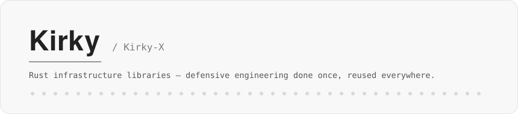

<picture>
  <source media="(prefers-color-scheme: dark)" srcset="assets/header-dark.svg">
  
</picture>

<br>


**Rust infrastructure libraries — defensive engineering done once, reused downstream.**

I build a suite of domain-specific Rust libraries — caching, configuration, logging, rate limiting, authentication, data access, crawling, embedding inference, LLM gateway — so that defensive code (security, fault tolerance, edge cases) is written once at the library layer and reused downstream, instead of re-rolled in every project.

## Rust crates

Published on [crates.io](https://crates.io), sorted by downloads. Download numbers refresh daily.

| Crate | Focus | Downloads |
| --- | --- | --- |
| [**oxcache**](https://github.com/Kirky-X/oxcache) · [crate](https://crates.io/crates/oxcache) | Multi-level cache with usage kept simple — single-flight, stale-while-revalidate, adaptive TTL; stampede defenses by default |  |
| [**trait-kit**](https://github.com/Kirky-X/trait-kit) · [crate](https://crates.io/crates/trait-kit) | Trait assembly boilerplate removed — typestate validation, service registry, no heavy DI framework |  |
| [**confers**](https://github.com/Kirky-X/confers) · [crate](https://crates.io/crates/confers) | Layered configuration with the merge pitfalls solved — derive-based, hot reload with canary rollout |  |
| [**inklog**](https://github.com/Kirky-X/inklog) · [crate](https://crates.io/crates/inklog) | Async logging that keeps your macros — PII redaction, rotation, backpressure, HMAC audit chain |  |
| [**limiteron**](https://github.com/Kirky-X/limiteron) · [crate](https://crates.io/crates/limiteron) | Nine rate-limit algorithms behind one decision chain — clock-drift pitfalls pre-solved |  |
| [**dbnexus**](https://github.com/Kirky-X/dbnexus) · [crate](https://crates.io/crates/dbnexus) | Data-access layer with SQL-injection defense and RBAC — two drivers, one identical API |  |
| [**zenith**](https://github.com/Kirky-X/zenith) · [crate](https://crates.io/crates/zenith) | Multi-language code formatter with automatic backup and one-click restore |  |
| [**sdforge**](https://github.com/Kirky-X/sdforge) · [crate](https://crates.io/crates/sdforge) | One `#[forge]` macro generates HTTP, gRPC, MCP, WebSocket and CLI — with OpenAPI and client SDKs |  |
| [**garrison**](https://github.com/Kirky-X/garrison) · [crate](https://crates.io/crates/garrison) | Authentication that fails closed — JWT, OAuth2/OIDC, RBAC+ABAC, brute-force protection |  |
| [**vecboost**](https://github.com/Kirky-X/vecboost) · [crate](https://crates.io/crates/vecboost) | Local embedding and decision inference — Candle/ONNX dual engine, semantic cache |  |
| [**codenexus**](https://github.com/Kirky-X/codenexus) · [crate](https://crates.io/crates/codenexus) | Code knowledge graph over 21 languages — Cypher queries, taint analysis, MCP server |  |
| [**crawlrs**](https://github.com/Kirky-X/crawlrs) · [crate](https://crates.io/crates/crawlrs) | Polite crawling as the default — five engines, anti-bot handling, SSRF protection |  |
| [**calnexus**](https://github.com/Kirky-X/calnexus) · [crate](https://crates.io/crates/calnexus) | Deterministic arithmetic as an external engine — REPL, batch mode, HTTP + MCP |  |
| [**ciphern**](https://github.com/Kirky-X/ciphern) · [crate](https://crates.io/crates/ciphern) | Security-first encryption — SM2/SM3/SM4 national standards plus AES/RSA/ECC, secure memory handling |  |
| [**nebulaid**](https://github.com/Kirky-X/NebulaId) · [crate](https://crates.io/crates/nebulaid) | Distributed IDs that survive clock drift — Snowflake clock-drift protection, UUID v8 |  |
| [**xlink**](https://github.com/Kirky-X/xlink) · [crate](https://crates.io/crates/xlink) | Unified messaging SDK — email, SMS, push and webhooks with end-to-end encryption |  |
| [**fluxweir**](https://github.com/Kirky-X/fluxweir) · [crate](https://crates.io/crates/fluxweir) | One gateway over LLM provider dialects — weighted routing, failover, circuit breaking |  |
| [**alchemize**](https://github.com/Kirky-X/alchemize) · [crate](https://crates.io/crates/alchemize) | Documents distilled into Markdown — skeleton at 0.0.0, format backends on the way |  |

## Open-source skills

Install any of them:

```bash
npx skills add Kirky-X/<repo> --agent claude-code -y
```

| Skill | Focus |
| --- | --- |
| [**Cangjie** 仓颉](https://github.com/Kirky-X/cangjie) | Content distillation — notes, video storyboards, de-AI-flavored rewriting, Excalidraw diagrams |
| [**Dayv** 大禹](https://github.com/Kirky-X/dayv) | Multi-ecosystem dependency analysis — dependency trees, version conflicts, OSV, SBOM |
| [**Diting** 谛听](https://github.com/Kirky-X/diting) | Code quality review — dimensional review, decay diagnosis, simplification |
| [**element-dev**](https://github.com/Kirky-X/element-dev) | Element Plus (Vue 3) development assistant with a local knowledge base |
| [**flutter-dev**](https://github.com/Kirky-X/flutter-dev) | Flutter/Dart development assistant — build errors, crash triage, offline knowledge base |
| [**hap-dev**](https://github.com/Kirky-X/hap-dev) | HarmonyOS app development assistant — ArkTS fixes, hvigor builds, crash evidence chain |
| [**Kueiku** 鬼谷子](https://github.com/Kirky-X/kueiku) | Methodology navigation compass — routes a task to the right framework across 19 categories |
| [**Liuxiang** 刘向](https://github.com/Kirky-X/liuxiang) | Academic research pipeline — paper search, 12-agent writing, 7-agent review |
| [**Lizhu** 离朱](https://github.com/Kirky-X/lizhu) | Document digitization to Markdown — PDF, Word, PPT, Excel, EPUB, images |
| [**Maliang** 马良](https://github.com/Kirky-X/maliang) | Frontend design generation — DESIGN.md to design tokens to cross-platform code |
| [**Ouyezi** 欧冶子](https://github.com/Kirky-X/ouyezi) | Performance optimization methodology — profile-driven, architecture-agnostic |
| [**Pangu** 盘古](https://github.com/Kirky-X/pangu) | Project harness initialization — scaffolds, CI, release, coverage gates in one pass |
| [**pua**](https://github.com/Kirky-X/pua) | Behavior-correction coach for agents — evidence-driven closure loops |
| [**Specmark**](https://github.com/Kirky-X/specmark) | Spec-driven change workflow — 8-stage state machine, filesystem as state |
| [**Tiangang** 天罡](https://github.com/Kirky-X/tiangang) | SAST security scanning — Semgrep plus language-specific scanners, CI gates |
| [**Wudaozi** 吴道子](https://github.com/Kirky-X/wudaozi) | Media generation — text-to-image, image understanding, video with deterministic routing |
| [**Xizhi** 羲之](https://github.com/Kirky-X/xizhi) | Icon set routing and auto-download — 21 first-class suites, Iconify fallback |

## Writing and notes

Long-form notes, project deep-dives and design essays live at **[kirky-x.github.io](https://kirky-x.github.io)**.

<picture>
  <source media="(prefers-color-scheme: dark)" srcset="https://raw.githubusercontent.com/Kirky-X/Kirky-X/output/snake-dark.svg">
  
</picture>
