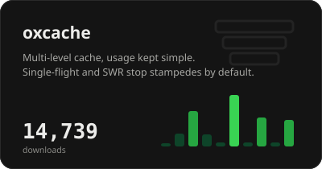
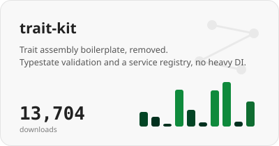
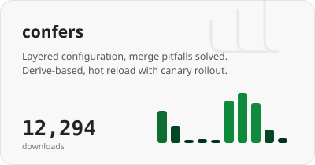
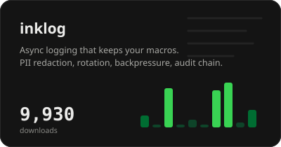
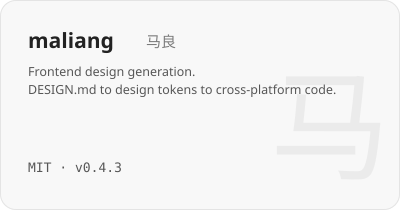
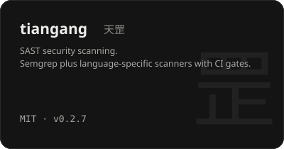
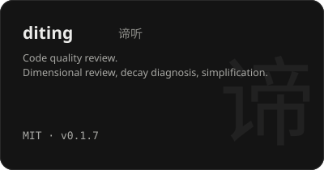
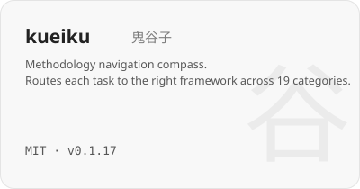

<picture>
  <source media="(prefers-color-scheme: dark)" srcset="assets/header-dark.svg">
  
</picture>

<br>


**Rust infrastructure libraries, built so defensive code is written once at the library layer and reused downstream.**

I design domain-specific Rust libraries for caching, configuration, logging, rate limiting, authentication, data access, crawling, embedding inference and LLM gatewaying. The defensive parts (security, fault tolerance, edge cases) are solved once in the library, and every downstream project inherits them.

## Core crates

[](https://github.com/Kirky-X/oxcache)&nbsp;&nbsp;[](https://github.com/Kirky-X/trait-kit)

[](https://github.com/Kirky-X/confers)&nbsp;&nbsp;[](https://github.com/Kirky-X/inklog)

All 18 libraries are published on crates.io. Card numbers refresh daily.

## Core skills

[](https://github.com/Kirky-X/maliang)&nbsp;&nbsp;[](https://github.com/Kirky-X/tiangang)

[](https://github.com/Kirky-X/diting)&nbsp;&nbsp;[](https://github.com/Kirky-X/kueiku)

17 open-source skills in total. Install any of them:

```bash
npx skills add Kirky-X/<repo> --agent claude-code -y
```

## Writing and notes

Long-form notes, project deep-dives and design essays live at **[kirky-x.github.io](https://kirky-x.github.io)**.

<picture>
  <source media="(prefers-color-scheme: dark)" srcset="https://raw.githubusercontent.com/Kirky-X/Kirky-X/output/snake-dark.svg">
  
</picture>
